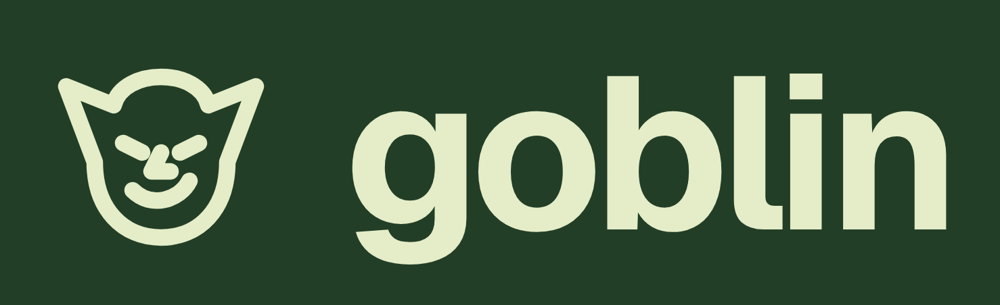

# goblin brand

The mark, app tiles, lockups and social images for goblin and Goblin Wallet. Every file here is public. Link to it at
`https://raw.githubusercontent.com/grmkris/goblin/main/brand/<file>`, or download the folder from GitHub.

## Colours

| Role                     | Name        | Hex       |
| ------------------------ | ----------- | --------- |
| Shell, the mark on light | moss        | `#233e27` |
| Rail, dark moss          | rail        | `#19301d` |
| The mark on moss         | lichen      | `#e4edc8` |
| Page                     | page        | `#fafaf9` |
| Text                     | ink         | `#0d1014` |
| Links and buttons        | moss accent | `#34653c` |

## Files

SVGs are vector. PNGs have transparent backgrounds, except the tiles, the `on-moss` and `on-page` lockups, and the link-preview and X images.

| File                                                                            | What it is                                                                              |
| ------------------------------------------------------------------------------- | --------------------------------------------------------------------------------------- |
| `goblin-mark-{moss,ink,lichen,white}.svg`, `-512.png`, `-1024.png`, `-2048.png` | The mark alone. Moss or ink on light backgrounds; lichen or white on moss or dark ones. |
| `goblin-tile-{moss,ink,page}.svg`, `-512.png`, `-1024.png`, `-2048.png`         | The mark on a rounded square: app icons, avatars, a hackathon logo.                     |
| `goblin-lockup-{on-moss,on-page,ink,white}.png`                                 | The mark with the name "goblin".                                                        |
| `goblin-wallet-lockup-{on-moss,on-page,ink,white}.png`                          | The mark with "Goblin Wallet".                                                          |
| `goblin-og-1200x630.png`, `goblin-wallet-og-1200x630.png`                       | Link previews and cover images.                                                         |
| `x-avatar-800.png`, `x-banner-1500x500.png`                                     | The [@goblin_surf](https://x.com/goblin_surf) profile photo and header.                 |

The live sites serve their own copies: `https://goblin.surf/icon-1024.png`, `/favicon.svg` and `/og.png`, and
`https://wallet.goblin.surf/favicon.svg` and `/wallet-og.png`. The app's icons are drawn from the same mark by
`bun run icons` ([development](../docs/development.md)).

## Where goblin lives

- Website: [goblin.surf](https://goblin.surf), and the wallet at [wallet.goblin.surf](https://wallet.goblin.surf)
- X: [@goblin_surf](https://x.com/goblin_surf)
- Source: [github.com/grmkris/goblin](https://github.com/grmkris/goblin)
