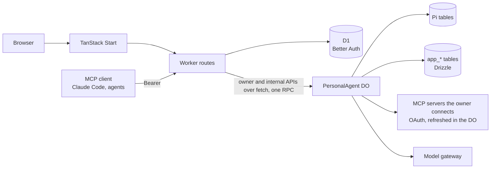

# Architecture

One Cloudflare Worker serves the web app and the API. Behind it, every user has their own `PersonalAgent` Durable
Object, named by their user ID: it runs Pi, holds that user's outbound MCP connections and credentials, and keeps
application state in its own SQLite. D1 holds Better Auth's account tables (users, sessions, inbound OAuth).

## Areas

- [Worker](architecture/worker.md): routes the Worker serves and how a request reaches the agent.
- [The owner API](architecture/owner-api.md): the typed HttpApi the agent serves, and the browser data layer.
- [Per-call MCP approval](architecture/mcp-approvals.md): Ask first, held calls and their decisions.
- [Accounts](architecture/accounts.md): sign-in, sign-up, the landing and first-run Start.
- [The agent object](architecture/agent.md): PersonalAgent, Pi, conversations, threads and subagents.
- [Outbound MCP](architecture/outbound-mcp.md): connections, OAuth, exact and batch grants and the MCP client.
- [Skills](architecture/skills.md): skills from MCP servers.
- [Chat blocks](architecture/chat-blocks.md): diagrams, charts and maps in replies.
- [MCP Apps host](architecture/mcp-apps.md): sandboxed server UIs.
- [Agent apps](architecture/agent-apps.md): apps goblin builds in Dynamic Workers.
- [Files](architecture/files.md): owner files in SQLite and R2.
- [Topics, Personas and memory](architecture/topics.md): Topics, Personas, organize receipts, retrieval and Topic memory.
- [Models](architecture/models.md): model calls and daily token usage.
- [Authority and inbound MCP](architecture/inbound-mcp.md): resident authority and goblin as an MCP server.
- [MCP Events](architecture/events.md): signed subscriptions, consumers and the event picker.
- [Sources](architecture/sources.md): any connection's events as the owner's own messages, routed to Topics and answered
  back.
- [Chat-driven setup](architecture/workspace-plans.md): composing Sources and routines into one durable review and
  continuing the original chat after activation.
- [Run ledger](architecture/observability.md): run ledger, logs, failures and inspection.
- [Storage](architecture/storage.md): D1, Durable Object SQLite and migrations.
- [Infrastructure and release](architecture/infrastructure.md): Alchemy stacks, stage origins, release and public source.
- [Routines and notices](architecture/routines.md): routine definitions, runs and notices.

Notify me via delivery rules and exact echo selectors are documented with [Sources](architecture/sources.md) (ADR 0071).

Interactive `openui` replies use the existing Markdown and owner-message paths; see [chat blocks](architecture/chat-blocks.md) and [ADR 0074](adr/0074-interactive-replies.md).
