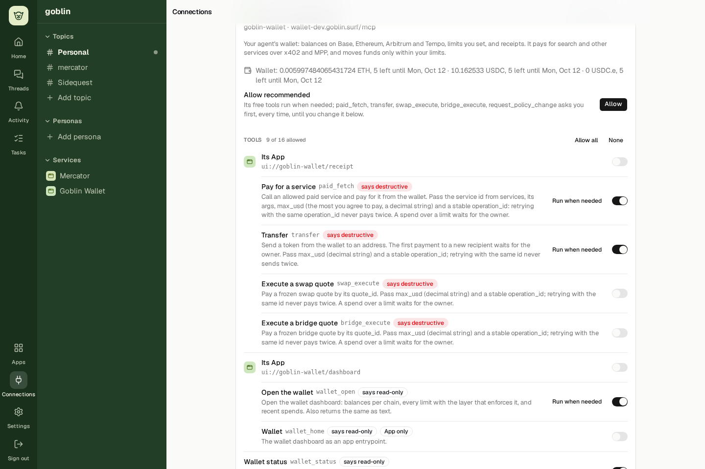
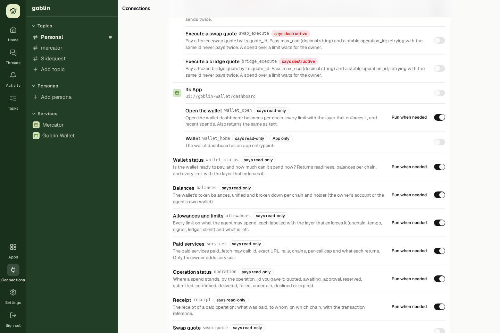
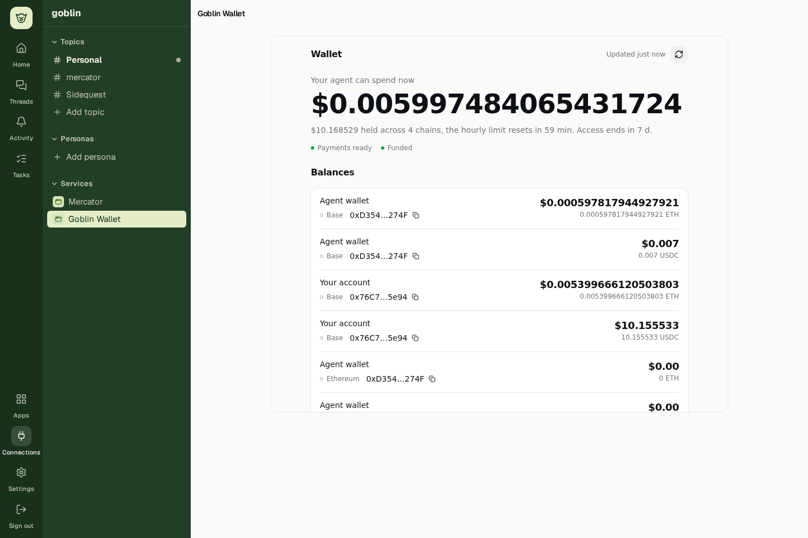
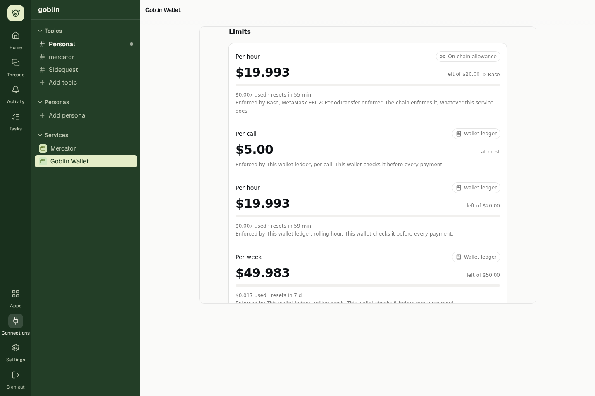
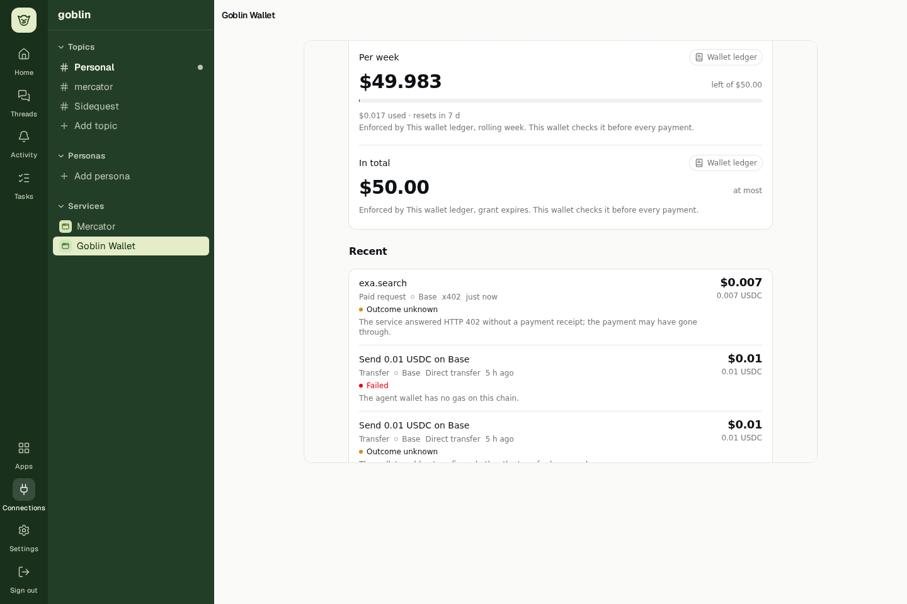
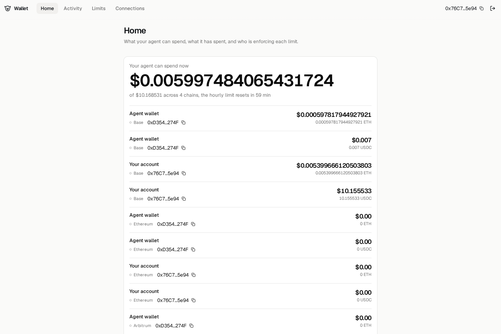
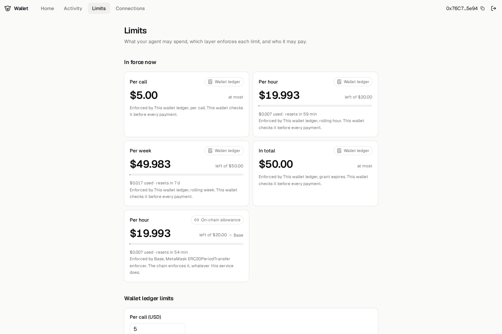

# Goblin Wallet: UX and UI improvement plan

**Status:** Proposed implementation handoff; no product code changed.

**Update, 12 October 2026 (later):** two sessions implemented this in parallel; `main` keeps the afternoon session's
overview (`overview-model.ts`, `views/overview.tsx`: one display model per network, shared by Home and the App, with
Add funds) and adds on top of it: unread chains as unknown and owner funds only where an allowance reaches them in
`wallet_status`; `site`, so the App opens Approve and the wallet site, and names a link the host refuses; uncertain
operations that keep their tx hash or x402 authorization, with `operation_check` / Check status settling, releasing or
leaving them and never paying; Limits as one line per limit; 40px copy targets; the App page filling its pane, taking
newer results live, asking for grants and reporting safe-area insets; Connections as summary cards with Manage access
and Review recommended access, Open without payment powers and an explicit call-policy select; and the wallet's Home
Screen icon and manifest. Real-iPhone safe areas, the installed icon and touch feel still need a device.

**Review mode:** Full, limited to the recorded Goblin → wallet MCP App → owner-console journey.

**Source baseline:** `eeaaa90d`, inspected on 12 October 2026. Line references describe that checkout; re-check them before editing.

**Screenshots:** Real deployed dev UI, 1440 × 960, recorded from 09:24:34 UTC on 12 October 2026. These are current-state evidence, not proposed designs. Another session was funding and changing the demo account; values are historical snapshots. The deployed revision was not independently established in this design pass.

**Start here:** Fix monetary meaning and permission clarity, then replace the long wallet scroll with a useful overview. Preserve Goblin's moss sidebar, Slack-like organization, and first-class MCP Apps. The wallet should feel like part of a person's working environment: they can immediately see what their agent can do, what it may spend, and what needs their attention.

The screenshots below are copied into a sibling directory so this document works in another checkout. The original [captioned walkthrough](../../.local/evidence/wallet/walkthrough-20261012-092434/goblin-wallet-walkthrough.mp4) is local and ignored by Git; the plan does not depend on it.

## Design brief and boundaries

The audience is an individual using a resident personal agent, with either hosted Goblin or their own deployment. The central job is to delegate useful work with understandable boundaries. This is a wallet for agent spending, rather than a portfolio or trading terminal.

The desired first-screen answers are:

1. Which wallet and MCP connection am I looking at?
2. What can this agent spend, in which asset and on which network?
3. What needs my attention, and what is the next useful action?
4. Where can I inspect or change permissions and spending limits?

The plan covers Connections, the embedded wallet dashboard, its refresh/balance/limit/activity states, and standalone Home and Limits. Wallet setup, approvals, signing, connection consent, chat receipts, mobile, and dark mode need a later browser pass. Source pointers for related states are included; they are not claimed as visually accepted.

Use these skills for implementation:

- [frontend-design](../../.agents/skills/frontend-design/SKILL.md): visual direction and information hierarchy.
- [make-interfaces-feel-better](../../.agents/skills/make-interfaces-feel-better/SKILL.md): static polish, typography, surfaces and controls.
- If changing the host sizing/bridge, additionally read [pi-stream-and-mcp-apps](../../.agents/skills/pi-stream-and-mcp-apps/SKILL.md). Read the applicable runtime and wallet instructions before changing contracts or status derivation.

Keep the current React/TanStack Start host, React/Vite wallet, Tailwind 4, local `@goblin/ui` shadcn components, CSS tokens, and Lucide icons. Goblin's existing component CSS remains appropriate for its shell and connection list. Do not add another styling system, font package, or animation dependency.

## Visual direction

### A recognizable Goblin wallet

Keep the moss navigation as the strongest brand element. Within the wallet, give emphasis to a compact **agent spending summary**: the usable asset, the relevant network, the active constraint and the next action. Use a quiet, readable activity list beneath it. Large amounts must earn their prominence by answering a real question.

These six hex values are visual references for the existing light-mode palette, not instructions to hardcode colors. Keep the existing OKLCH definitions and map through semantic tokens in [packages/ui/src/styles.css](../../packages/ui/src/styles.css#L83).

| Name      | Reference | Role                                       |
| --------- | --------- | ------------------------------------------ |
| Deep moss | `#1A311F` | Main navigation rail                       |
| Moss      | `#213D27` | Workspace sidebar and brand continuity     |
| Lichen    | `#E3EECD` | Selected service or channel                |
| Canvas    | `#FAFAFA` | Working surface                            |
| Paper     | `#FFFFFF` | Forms, elevated controls and grouped lists |
| Ink       | `#14181B` | Primary text                               |

Keep the existing success, attention and destructive tokens for state, with text labels. The dark theme inherits the existing dark tokens; these light references are not a replacement dark palette. Contrast still needs measurement.

**Type:** Retain Geist Variable for the host and standalone wallet. MCP Apps use the host font stack and system fallback; do not assume a cross-origin font is available or loosen CSP to fetch it. Use 14–16 px body text, 13 px supporting text, 16–20 px section titles and a bounded 32–40 px primary amount. Use tabular figures for amounts and timestamps; reserve monospace for actual addresses, operation IDs and optional technical details. Titles and prose stay left aligned; amounts align to the right within rows. Keep descriptions around 60–72 characters per line.

**Surfaces:** One main working surface, with grouped rows rather than a separate card for every fact. Keep structural dividers and visible focus rings. Reserve elevation for overlays and controls that actually float. Where surfaces nest, choose radii from the existing tokens to preserve the outer-radius/inner-radius/padding relationship.

**Spacing:** Use the existing 4 px scale: 8 px within a fact, 12–16 px within a row, 20–24 px between groups. A compact visual control still needs a non-overlapping 40 px desktop or 44 px touch target.

### Layout alternatives considered

**A — Recommended: overview with focused tabs.** A persistent wallet header, an attention row when needed, compact spending and permission facts, then Overview / Activity / Limits. Balances are grouped and secondary. On wide surfaces, a narrow limits summary can sit beside activity; narrow surfaces stack in reading order.

```text
Goblin shell | Goblin Wallet                  Connection details
             | Updated 11:24                 Refresh   Open wallet site
             |---------------------------------------------------------
             | Needs attention: Search payment not confirmed   View details
             |---------------------------------------------------------
             | Available for agent spending
             | [amount + asset + network, or a specific blocker]
             | Per payment [cap]     Remaining this hour [amount]
             |---------------------------------------------------------
             | Overview       Activity       Limits
             | Recent work                  | Spending boundaries
             | Search • status • amount     | Network / layer / expiry
             | Transfer • status • amount   | View all limits
             |---------------------------------------------------------
             | Assets: Base                 | Other networks [3]
             | USDC  [agent] [owner]         | Show zero balances
             | ETH   [gas balance]           |
```

The drawing describes hierarchy, not fabricated live balances. Network, asset, allowance and eligibility must come from corrected data. The visual “available” amount is not permission to execute a payment.

**B — Alternative: one expanded page.** Keep Balances, Limits and Activity in a single document with anchor navigation. It is simpler, but the recorded number of balance rows still makes important information easy to bury. Use this only if the compact overview proves insufficient in usability review.

**Review against the brief:** A default fintech card grid would turn this into a generic wallet. Replace that starting idea with an agent spending summary and work-related activity, while preserving the recognizable Goblin shell. Avoid balance charts, decorative gradients, another mascot illustration in the dashboard, and new typography. Spend visual emphasis on the relationship between delegation, a useful task and its outcome.

## Findings and implementation direction

There are **13 consolidated findings: 3 HIGH and 10 MEDIUM**. IDs below are reused by the screenshot sections. All are proposals, not completed changes.

### Honest amounts and stable typography

| Severity         | Location                                                                                                                                                                                             | Before                                                                                                                                                              | After                                                                                                                                                                                                                                                                                                                    | Why                                                                                                                           |
| ---------------- | ---------------------------------------------------------------------------------------------------------------------------------------------------------------------------------------------------- | ------------------------------------------------------------------------------------------------------------------------------------------------------------------- | ------------------------------------------------------------------------------------------------------------------------------------------------------------------------------------------------------------------------------------------------------------------------------------------------------------------------ | ----------------------------------------------------------------------------------------------------------------------------- |
| **HIGH — F01**   | `apps/wallet-web/src/views/dashboard.tsx:50`, `:74`; `apps/wallet-web/src/pages/home.tsx:13`, `:39`; `apps/wallet-web/src/views/money.ts:4`; `apps/wallet/src/services/programs/derive-status.ts:18` | Token quantities are passed as USD, heterogeneous balances are added, the first token becomes the hero, and status derivation pools owner/agent holdings by symbol. | Model token quantity, optional valuation, chain, holder, eligibility and freshness separately. Show gas as ETH; show spendability per supported payment asset/network. Unknown valuation or eligibility stays unknown. Only include owner funds covered by a verified usable allowance; do not imply automatic bridging. | Monetary meaning is a prerequisite to visual hierarchy. Shortening the decimal string would hide the error without fixing it. |
| **MEDIUM — F02** | `apps/wallet-web/src/ui/format.ts:7`, `:14`; `apps/wallet-web/src/ui/amount.tsx:4`; `apps/web/src/components/first-class.tsx:45`                                                                     | All decimals survive into oversized headings and connection summaries.                                                                                              | Define separate compact balance and exact transaction formats. Use a bounded amount size, tabular digits and exact-value disclosure that works on focus/tap. Preserve `$0.007` for a real charge and never turn a positive spendable amount into zero through rounding.                                                  | Stable typography and deliberate hierarchy make money readable without losing precision.                                      |

### Understandable authority and progressive disclosure

| Severity         | Location                                                                                                                                                                 | Before                                                                                                                                              | After                                                                                                                                                                                                                                                                                                                          | Why                                                                                                                                                                                                       |
| ---------------- | ------------------------------------------------------------------------------------------------------------------------------------------------------------------------ | --------------------------------------------------------------------------------------------------------------------------------------------------- | ------------------------------------------------------------------------------------------------------------------------------------------------------------------------------------------------------------------------------------------------------------------------------------------------------------------------------ | --------------------------------------------------------------------------------------------------------------------------------------------------------------------------------------------------------- |
| **HIGH — F03**   | `apps/web/src/components/tool-grants.tsx:64`                                                                                                                             | Clicking the text “Run when needed” immediately toggles `askFirst`; it is not a menu.                                                               | Use an explicitly labeled execution-policy selector showing the present value and explicit choices. Keep the tool's allowed state distinct. Change policy only after a choice, show in-flight state and the confirmed result, and retain the old state on failure.                                                             | Predictable controls matter when a click changes what an agent may do. A control that looks informational must not silently change authority.                                                             |
| **MEDIUM — F04** | `apps/web/src/components/tool-grants.tsx:104`; `apps/web/src/components/server-app.tsx:39`                                                                               | “Its App” repeats, exposes raw `ui://` paths, and displays off whenever `tools.every(granted)` is false, even when an owner can open the dashboard. | Name groups “Wallet dashboard” and “Payment receipts.” Represent partial access as “Some tools allowed” or a mixed group indicator. Distinguish opening a view as the owner from tools the agent can call. Show the exact resource/tool set in details.                                                                        | Group state must express its actual semantics. The screenshot is not evidence of an authorization bypass; it reveals a misleading summary.                                                                |
| **MEDIUM — F05** | `apps/web/src/components/server-card.tsx:80`; `apps/web/src/components/first-class.tsx:87`; `apps/web/src/components/tool-grants.tsx:53`; `apps/web/src/styles.css:1340` | Long server/tool descriptions, endpoint names and repeated badges dominate Connections. “Allow recommended” lists raw tool identifiers.             | Start with compact connection summaries using the curated product name, endpoint secondary, connection state and Open / Manage access actions. Expand only the selected connection. In its details, group capabilities by purpose and collapse technical descriptions. A recommended-access review lists exactly what changes. | Progressive disclosure and readable line length reduce scanning without hiding consequential permissions. Remote “read-only” and “destructive” annotations remain attributed claims, never authorization. |

### Space, grouping and surfaces

| Severity         | Location                                                                                                                                                                   | Before                                                                                                                                                                  | After                                                                                                                                                                                                                                                                                         | Why                                                                                                                                           |
| ---------------- | -------------------------------------------------------------------------------------------------------------------------------------------------------------------------- | ----------------------------------------------------------------------------------------------------------------------------------------------------------------------- | --------------------------------------------------------------------------------------------------------------------------------------------------------------------------------------------------------------------------------------------------------------------------------------------- | --------------------------------------------------------------------------------------------------------------------------------------------- |
| **MEDIUM — F06** | `apps/web/src/components/server-app.tsx:45`; `apps/web/src/components/apps/frame.tsx:272`; `apps/web/src/lib/host-context.ts:113`; `apps/wallet-web/src/views/frame.tsx:7` | A dedicated service page reuses an inline-only wrapper capped at 70% of viewport height with a fixed reported width of 720 px. The App cannot request fullscreen there. | Give service pages a real page placement with measured available width/height and supported display modes. Use the available workspace area and one intentional vertical scroller. Let the wallet respond to the actual host dimensions; use the compact layout when the host is small.       | Layout should follow the task's surface. This is a host integration change, not just increasing the wallet's CSS height.                      |
| **MEDIUM — F07** | `apps/wallet-web/src/views/dashboard.tsx:74`, `:186`; `apps/wallet-web/src/pages/home.tsx:56`                                                                              | Every holder × asset × chain is a separate row; zero balances push activity and limits below the fold. Addresses repeat on every row.                                   | Show attention and a recent-work preview before the full asset list. Group assets by chain with distinct Agent / Your account quantities; show an address once per group. Keep nonzero, payment-relevant and blocked assets visible; put other zero balances behind a counted disclosure.     | Information structure should foreground the user's next decision. Zero and unreadable balances must remain distinct.                          |
| **MEDIUM — F08** | `apps/wallet-web/src/ui/limit-meter.tsx:16`; `apps/wallet-web/src/ui/layer.tsx`; `apps/wallet-web/src/pages/limits.tsx:206`                                                | Several equally prominent amount cards repeat periods and technical enforcement paragraphs. Tiny usage yields nearly invisible meter fill.                              | Use a compact comparison of period, allowed amount, remaining, layer/network and reset/expiry. Explain the effective constraint for the selected asset and action, with expandable enforcement details. Keep exact usage text; do not artificially inflate a tiny meter.                      | Structure should explain how limits combine. On-chain and ledger ceilings are independent constraints, not additive budgets.                  |
| **MEDIUM — F09** | `apps/wallet-web/src/pages/home.tsx:39`; `apps/wallet-web/src/app/shell.tsx:70`; `apps/wallet-web/src/views/dashboard.tsx:155`                                             | Standalone Home duplicates a long, slightly different dashboard with separate amount aggregation logic.                                                                 | Reuse one corrected display model and shared overview sections. The owner site adds owner actions, while the embedded App stays useful inside its host. Keep the selected network/asset and terminology consistent when opening the owner site; convey only non-sensitive navigation context. | Consistent identity and behavior reduce relearning and stop the same bug recurring in two views.                                              |
| **MEDIUM — F10** | `apps/wallet-web/src/pages/limits.tsx:104`, `:199`; `apps/wallet-web/src/pages/limit-draft.ts`                                                                             | “In force now” consumes most of a desktop screen before editable limits; controls, service rules and address book follow in one long page.                              | Separate the read-only effective summary from “Wallet limits you can change,” “On-chain allowance,” “Allowed services” and “Recipients.” Give the editor a visible change summary and save feedback. Explain when a chain signature is required. Preserve dirty input on background refresh.  | The layout must distinguish editing a setting from signing a different enforcement layer. A smaller summary brings the actual task into view. |

### Useful outcomes and interaction feedback

| Severity         | Location                                                                                                                                                                                  | Before                                                                                                                                                                                                                            | After                                                                                                                                                                                                                                                                                                                                          | Why                                                                                                                                                                      |
| ---------------- | ----------------------------------------------------------------------------------------------------------------------------------------------------------------------------------------- | --------------------------------------------------------------------------------------------------------------------------------------------------------------------------------------------------------------------------------- | ---------------------------------------------------------------------------------------------------------------------------------------------------------------------------------------------------------------------------------------------------------------------------------------------------------------------------------------------- | ------------------------------------------------------------------------------------------------------------------------------------------------------------------------ |
| **HIGH — F11**   | `apps/wallet-web/src/ui/receipt-row.tsx:29`; `apps/wallet-web/src/pages/activity.tsx:8`; `apps/wallet-web/src/views/receipt.tsx:132`; `apps/wallet-web/src/views/receipt-model.ts:42`     | “Outcome unknown” and “Failed” are passive rows. Most rows do not open details; a transaction link exists only when payment evidence is present. The displayed amount does not say whether it was requested, reserved or charged. | Make every operation inspectable. Lead with the job (“Exa search”), then separate payment and delivery states, requested/held/charged amounts, timestamp and known evidence. Offer a read-only Check status only where supported; otherwise say what evidence is unavailable. Never make Retry payment the default for an uncertain operation. | Recovery must be actionable and financially honest. Missing transaction evidence needs backend work; a UI redesign cannot invent it or promise that nothing was charged. |
| **MEDIUM — F12** | `apps/wallet-web/src/ui/copy-button.tsx:29`; `apps/wallet-web/src/ui/receipt-row.tsx:45`; `packages/ui/src/components/button.tsx:40`; `apps/web/src/components/tool-grants.tsx:65`        | Compact copy controls are 24 px and regular icon buttons 32 px visually; transaction links use `min-h-6`. Shared coarse-pointer expansion exists, but desktop controls remain smaller than the requested quality floor.           | Use 40 px desktop / 44 px touch interaction areas, measured including pseudo-elements. Keep icons visually small, align them to adjacent text, use consistent Lucide weight and preserve focus outlines. Ensure neighboring expanded targets do not overlap.                                                                                   | Minimum hit area and optical alignment improve accuracy. Do not replace the whole shared component or duplicate its existing touch expansion.                            |
| **MEDIUM — F13** | `apps/wallet-web/src/views/dashboard-main.tsx:18`; `apps/wallet-web/src/views/dashboard.tsx:119`; `apps/wallet-web/src/views/use-wallet-app.ts:45`; `apps/wallet-web/src/ui/async.tsx:46` | Refresh feedback is quiet header text; a refused external link is silently swallowed in code. Wallet-wide freshness does not express partial network reads.                                                                       | Keep the last good data during refresh and visibly distinguish refreshing, stale and failed reads. Say “Updated at…” with an inspectable timestamp. Report refused links with a useful fallback. When the backend supports it, expose per-network read status so a failed read is not rendered as zero.                                        | Every action needs observable feedback. This row includes source-observed error behavior; those failure states were not triggered in the walkthrough.                    |

## Screenshot-by-screenshot handoff

Each image is an unchanged frame from the same walkthrough. Source links below are implementation entry points, not permission to replace the surrounding runtime or weaken the MCP boundary.

### 1. Connections: make the wallet identifiable and manageable



**Video:** about 00:00. **Findings:** F02–F05, F12.

The view is already scrolled deep into a connection. Its heading is above the visible area and “Allow recommended” competes with a long list of powers. Replace this with a compact service summary and an intentional expanded access view. Use “Goblin Wallet” as the product name, preserve the owner's custom label, and keep the endpoint available below it. Put Open wallet and Manage access together. Opening a read-only owner view must not depend on accepting all recommended payment powers.

Within Manage access, show “Read wallet,” “Spend or move funds,” and “Wallet views” as organizational groups, then the exact tools within each. Grouping is presentation only: do not infer grants from descriptions or globally allow a new tool because it landed in a group. Replace “Allow recommended” with “Review recommended access” and a concrete list of the resulting grants and ask-first policies.

**Relevant files:** [server-card.tsx](../../apps/web/src/components/server-card.tsx#L80), [first-class.tsx](../../apps/web/src/components/first-class.tsx#L87), [tool-grants.tsx](../../apps/web/src/components/tool-grants.tsx#L137), [connections.tsx](../../apps/web/src/components/connections.tsx), [styles.css](../../apps/web/src/styles.css#L1340).

**Acceptance:** With seven existing servers, the wallet's identity, connected state and primary actions are visible without scrolling through another server's tool catalogue. Viewing access never mutates it.

### 2. Tool permissions: distinguish access, policy and partial groups



**Video:** about 00:08. **Findings:** F03–F05, F12.

Use a clean row: capability name, a one-sentence purpose, Allowed state, and the current execution policy. Put raw tool name, annotations and the full description under Details. Preserve the distinction between “tool allowed” and “ask before each call”; if presented as a single three-state control, the implementation must handle both backend writes without temporarily widening access or reporting partial success as completion.

Source review resolves the apparent off-switch contradiction: AppGroup derives its state from `tools.every(granted)`. A partially granted group therefore looks completely off. Use a proper mixed summary, readable group names and exact child counts. Explicit owner opening and agent tool permission are also different paths; explain that distinction in the access view.

**Relevant files:** [ToolRow and AppGroup](../../apps/web/src/components/tool-grants.tsx#L39), [grant mutations](../../apps/web/src/components/tool-grants.tsx#L195), [MCP queries](../../apps/web/src/mcp/queries.ts), [Switch](../../packages/ui/src/components/switch.tsx), [Button](../../packages/ui/src/components/button.tsx).

**Acceptance:** Partial groups are identifiable without opening every row. Inspecting a policy leaves grants untouched. Choosing an explicit policy reports pending, success or failure accurately. Test the exact tool/resource authorization separately from visual state.

### 3. Embedded overview: correct the money and use the workspace


**Video:** about 00:18. **Findings:** F01, F02, F06, F07.

This is the highest-impact redesign. The headline is currently the first status token's quantity rendered as USD, and ETH rows repeat their token quantity with a dollar sign. Build the corrected monetary display model first. Prefer explicit “USDC on Base available for agent spending” over an apparently universal dollar balance. If eligibility cannot be established, show a precise unavailable state with the last verified timestamp.

Give the dedicated wallet page the available pane, then show attention, spending context and recent work before the full asset list. Group Base's asset rows into a small table, with ETH visibly designated as gas and owner holdings separate. Keep the remaining networks discoverable without scrolling past zero rows.

**Relevant files:** [Spendable and Balances](../../apps/wallet-web/src/views/dashboard.tsx#L50), [amount formatter](../../apps/wallet-web/src/ui/format.ts#L7), [amount component](../../apps/wallet-web/src/ui/amount.tsx#L15), [status derivation](../../apps/wallet/src/services/programs/derive-status.ts#L50), [status contract](../../packages/wallet/src/contract/status.ts#L31), [server page](../../apps/web/src/components/server-app.tsx#L45), [inline wrapper](../../apps/web/src/components/apps/frame.tsx#L272), [host dimensions](../../apps/web/src/lib/host-context.ts#L95).

**Acceptance:** No ETH quantity is labeled USD without an actual valuation. The hero does not depend on token array order. At 1440 × 960, an attention item, usable spending context and limits entry point are visible without scrolling through balances. Dedicated-page dimensions match the real container.

### 4. Balance refresh: communicate freshness without losing context



**Video:** about 00:26. **Findings:** F01, F02, F12, F13.

Keep the useful current behavior: refreshing retains the previous result and disables the refresh button. Make the updated timestamp and stale state easier to inspect, and use a stable header so the action remains reachable after scrolling. A failure must say which read failed while retaining visibly stale data; it must not silently become `$0.00`. Do not show a success toast on every routine refresh.

This frame demonstrates a successful refresh interaction only. It does not demonstrate a failed RPC, loading skeleton, hover state or keyboard interaction. Include those in the implementation's browser matrix.

**Relevant files:** [DashboardView refresh](../../apps/wallet-web/src/views/dashboard-main.tsx#L18), [Header](../../apps/wallet-web/src/views/dashboard.tsx#L101), [useWalletApp](../../apps/wallet-web/src/views/use-wallet-app.ts), [readStatus](../../apps/wallet/src/services/programs/status.ts#L23), [Async](../../apps/wallet-web/src/ui/async.tsx#L36).

**Acceptance:** Refresh does not reset the selected tab, filters, scroll or expanded operation. Failure leaves a truthful last-known result with retry-read guidance. Unknown network balances have a different presentation from a verified zero.

### 5. Limits in the App: show how boundaries combine



**Video:** about 00:34. **Findings:** F06, F08.

Keep the enforcement labels; they are valuable. Replace repeated large cards and prose with a compact comparison and expandable explanation. For the selected operation scope, show the per-payment cap, remaining hourly/weekly allowance and expiry, then what enforces each. A user should understand why two hourly limits can coexist and why changing one does not change the other.

Do not compute a universal “tightest” amount by comparing unrelated tokens, chains or periods. Show fees separately where known. A signer limit absent from the payload must be marked unavailable or supplied by the backend, not silently omitted from a claim of complete coverage. Small nonzero usage should remain visible as text without exaggerating the meter fill.

**Relevant files:** [LimitMeter](../../apps/wallet-web/src/ui/limit-meter.tsx#L16), [layer labels](../../apps/wallet-web/src/ui/layer.tsx), [Dashboard limit ordering](../../apps/wallet-web/src/views/dashboard.tsx#L151), [limit contract](../../packages/wallet/src/contract/limits.ts), [readLimits](../../apps/wallet/src/services/programs/status.ts#L13).

**Acceptance:** The same period at two layers is explained as two constraints. A changeable wallet setting is visibly different from an on-chain allowance. Missing layer data does not imply unlimited spending.

### 6. Activity: make uncertain outcomes inspectable



**Video:** about 00:43. **Findings:** F07, F11, F13.

Move unresolved work into an attention row near the top of Overview. Open an operation detail view on selection, including operations without transaction hashes. For this Exa request, say “Search payment not confirmed” and explain that the provider returned HTTP 402 without a receipt. Distinguish the requested amount from an actual confirmed charge. Show operation ID, last check, network and known transaction evidence in a details section.

Reuse the receipt model's separation of payment and delivery, after checking its semantics against current backend behavior. Check status must inspect the existing operation. If reconciliation does not exist, the action should be unavailable with honest guidance; a fresh spend is not a substitute. Only offer payment retries when the original outcome has been resolved and authorization still applies.

**Relevant files:** [ReceiptRow](../../apps/wallet-web/src/ui/receipt-row.tsx#L29), [standalone activity](../../apps/wallet-web/src/pages/activity.tsx#L8), [Receipt](../../apps/wallet-web/src/views/receipt.tsx#L121), [receipt model](../../apps/wallet-web/src/views/receipt-model.ts#L42), [status pill](../../apps/wallet-web/src/ui/status-pill.tsx), [operation contract](../../packages/wallet/src/contract/operations.ts).

**Acceptance:** A person can answer “Was I charged?” and “Did the service deliver?” separately, including when either answer is unknown. Every row opens details. An uncertain operation has no one-click action that submits a new payment. Backend reconciliation is a separate dependency, not a cosmetic promise.

### 7. Standalone Home: share the overview, add owner controls



**Video:** about 00:54. **Findings:** F01, F02, F07, F09.

Share the corrected overview and display model with the embedded App. Keep Home, Activity, Limits and Connections in the standalone navigation, but give Home a clearer job: what the agent may spend and what requires the owner's attention. The owner site can add appropriate funding, allowance and connection-management entry points; these must lead to the existing explicit owner flows.

Use the wider desktop space for a main activity column and a compact boundaries/context column where content warrants it, without stretching paragraphs. On mobile, attention comes first, then spending context, recent work and assets. The shell can remain visually quieter than Goblin's main sidebar while using the same spacing, type and component language.

**Relevant files:** [HomePage](../../apps/wallet-web/src/pages/home.tsx#L76), [Balance](../../apps/wallet-web/src/pages/home.tsx#L39), [Shell](../../apps/wallet-web/src/app/shell.tsx#L70), [Page / Section / RowList](../../apps/wallet-web/src/ui/page.tsx), [Dashboard](../../apps/wallet-web/src/views/dashboard.tsx#L155), [money helper](../../apps/wallet-web/src/views/money.ts).

**Acceptance:** Given the same data and asset scope, owner Home and the MCP App show the same monetary meaning, state vocabulary and limit labels. Share presentation and pure transformations, not Privy credentials or server signing modules.

### 8. Owner Limits: bring editing into view



**Video:** about 01:03. **Findings:** F08, F10, F12.

Compress the read-only summary and place the editable wallet limits beside or immediately after it. Give the form a clear “Wallet limits” title and explain the effect of Save. Show old → new values before saving changes, the affected layer and the expected remaining capacity without pretending to alter a separate on-chain ceiling. Keep the on-chain allowance in its own section with its appropriate signature flow.

Below that, use distinct sections for Allowed services and Recipients. Service rules should show a human-readable name, network, per-call cap and optional exact endpoint details. Existing ledger validation and permission semantics remain authoritative. Confirm persisted values after a save; a failed save keeps the draft and says that the limit is unchanged.

**Relevant files:** [LedgerForm and LimitsPage](../../apps/wallet-web/src/pages/limits.tsx#L104), [limit draft validation](../../apps/wallet-web/src/pages/limit-draft.ts), [PolicyRequests](../../apps/wallet-web/src/pages/policy-requests.tsx), [LimitMeter](../../apps/wallet-web/src/ui/limit-meter.tsx), [query/mutation adapters](../../apps/wallet-web/src/api/queries.tsx).

**Acceptance:** At the recorded desktop size, the first editable field and its explanation are visible without paging through five summary cards. The user can distinguish a ledger edit from an allowance signature. A refetch cannot silently discard an unsaved form.

### 9. Return to Goblin: make the service feel resident


**Video:** about 01:16. **Findings:** F06, F09, F13.

The service sidebar already supplies a strong product relationship: the wallet sits beside Mercator within the same workspace. Preserve that. Returning should keep the selected wallet section and relevant operation context where supported, while visibly refreshing stale data. Keep connection identity and an owner-console entry point discoverable in host chrome so the App does not need to mimic Goblin navigation.

Use MCP host context and supported view-state mechanisms. Do not reach into the sandbox from host CSS, remove opaque frames, transfer credentials, or let a remote App change its originating connection. Restoring a view must never rerun a paid tool.

**Relevant files:** [ServerAppPage](../../apps/web/src/components/server-app.tsx#L54), [AppFrame / McpApp](../../apps/web/src/components/apps/frame.tsx#L272), [host context](../../apps/web/src/lib/host-context.ts#L73), [App bridge](../../apps/web/src/lib/app-bridge.ts#L66), [wallet app lifecycle](../../apps/wallet-web/src/views/use-wallet-app.ts#L20), [sidebar](../../apps/web/src/components/shell/sidebar.tsx).

**Acceptance:** Returning does not lose the user's place or trigger a new spend. The host reports real available dimensions and supported modes. External links remain host-mediated and a refusal gives feedback.

## Implementation sequence for the next agent

Work in coherent commits with explicit owned paths. Re-read the repository instructions and current Git state; the source may have moved since this snapshot. The existing unrelated `evidence/handoffs/topic-persona-capabilities-20261010.md` was left untouched.

| Order | Deliverable                                  | Findings | Dependencies and completion evidence                                                                                                                                                                                                         |
| ----- | -------------------------------------------- | -------- | -------------------------------------------------------------------------------------------------------------------------------------------------------------------------------------------------------------------------------------------- |
| 1     | Correct monetary meaning and display formats | F01, F02 | Agree on per-asset/chain eligibility, unknown states and valuation semantics before laying out the hero. Meaningful tests cover ETH vs USD, owner funds without usable allowance, reordered tokens, partial failures and exact microcharges. |
| 2     | Connection and permission redesign           | F03–F05  | Keep current backend grants authoritative. Test partial App groups, explicit policy selection, failed mutations and the owner/agent distinction. Capture the compact list and expanded access view.                                          |
| 3     | Dedicated App page placement                 | F06      | Reuse the secure bridge and actual container measurements. Test small/large containers, resizing, mode negotiation and teardown. Capture the wallet plus another MCP App so a wallet-specific fix does not break generic hosting.            |
| 4     | Shared wallet overview and limits summary    | F07–F09  | Depends on the corrected display model and container behavior. Build shared sections, asset grouping, attention, activity preview and scoped boundary summary. Review embedded and standalone side by side.                                  |
| 5     | Outcome details and owner editing            | F10, F11 | Resolve payment-data/reconciliation gaps separately. Then add inspectable operations, clear requested/held/charged labels, change preview and truthful save feedback. No invented retries or success states.                                 |
| 6     | Interaction and visual finish                | F12, F13 | Measure target areas, focus, typography, contrast and responsiveness. Exercise stale/error/empty states and rejected links. No broad shared-component restyling without checking its consumers.                                              |

Suggested shared abstractions, only where the implementation needs them: a pure wallet display model, a balance-group renderer, a compact boundary summary and operation details. Keep owner mutation adapters outside the MCP App's presentation components. Prefer the existing components before adding abstractions.

## State and acceptance matrix

These are implementation checks to perform, not claims that the current screenshots passed them.

| Area          | Required states / interactions                                                                                                    | Expected behavior                                                                                                                                                                                   |
| ------------- | --------------------------------------------------------------------------------------------------------------------------------- | --------------------------------------------------------------------------------------------------------------------------------------------------------------------------------------------------- |
| Money         | Zero; positive amount below a cent; large quantity; long token precision; missing valuation; ETH and USDC; unavailable chain read | Correct units, legible compact display, exact transaction amount recoverable, unknown distinct from zero. Decimal strings/base units stay exact; no floating-point arithmetic for financial totals. |
| Authority     | Owner funds with no usable allowance; partial allowance; gas only; expired/revoked grant; unsupported rail                        | Readiness explains the blocker. Available for spending is scoped to supported execution, not gross holdings.                                                                                        |
| Permissions   | Off, allowed, ask-first, partially allowed App, denied/pending/failed mutation                                                    | Visual state agrees with server authority. Inspection changes nothing. Never silently widen grants.                                                                                                 |
| MCP surface   | Inline receipt; dedicated page; 390 px phone; 768 px tablet; 1280 and 1440 px desktop; resizing; return navigation                | One deliberate primary scroller, real dimensions, supported mode negotiation, stable origin/connection binding and no repeated paid call.                                                           |
| Feedback      | Initial load; refresh; stale data; partial failure; permission denial; refused external link                                      | Readable status and recovery, previous data labeled accurately, focus remains stable.                                                                                                               |
| Operations    | Awaiting approval; submitted; paid but undelivered; uncertain; failed; delivered                                                  | Payment and delivery shown separately. Never label a mere submission complete or unknown amount charged.                                                                                            |
| Owner editing | Invalid amount; no changes; valid draft; background refetch; failed save; successful persisted readback                           | Exact scope of changes is visible, draft is preserved, and no chain allowance is implied to change on ledger save.                                                                                  |
| Visual finish | Light/dark; keyboard; 200% zoom; coarse/fine pointer; focus/hover/active/disabled; reduced motion                                 | No overflow, meaningful contrast, visible focus, accessible names and non-overlapping target areas.                                                                                                 |

If motion changes, replay it at 10% speed and test reduced motion. Avoid new entrance animations on routine wallet refreshes, a counting-money animation, `transition: all`, or speculative `will-change`. The existing 200 ms inline-height transition needs regression inspection when page placement changes, not automatic replacement.

## Coverage of the requested skills

| Category    | Evidence inspected                                                                                             | Result                                                                                                                                                                                      |
| ----------- | -------------------------------------------------------------------------------------------------------------- | ------------------------------------------------------------------------------------------------------------------------------------------------------------------------------------------- |
| Typography  | All nine screenshots; `Amount`, `formatUsd`, `WalletLine`, tool rows, shared Geist/theme tokens                | F02 and F05. Tabular numbers already exist; preserve them. Unit truth is separately covered by F01.                                                                                         |
| Surfaces    | Embedded and standalone screens; `ServerAppPage`, `McpApp`, `host-context`, `ViewFrame`, Home, Limits, RowList | F06–F10. Current grouping and sizing bury the useful work.                                                                                                                                  |
| Animations  | Source for App height transition, query/refresh states, shared control tokens; ordinary recorded navigation    | No new animation finding asserted. **Not verified:** browser Animations panel at 10% speed, interruptions, hover/active and reduced-motion playback.                                        |
| Icons       | Refresh/copy/transaction controls in screenshots; Lucide imports; shared button and switch target rules        | F12. Touch expansion already exists; measure actual target bounds before editing.                                                                                                           |
| Performance | Source for shared components, host context, iframe bridge and refresh lifecycle                                | No measured performance claim. **Not verified:** traces, iframe resize loops, duplicate fetch counts or App bundle comparisons. Preserve existing SDK/lifecycle and avoid new dependencies. |

## Considered but rejected

| Location               | Candidate                                                      | Rejected because                                                                                                                                                              |
| ---------------------- | -------------------------------------------------------------- | ----------------------------------------------------------------------------------------------------------------------------------------------------------------------------- |
| Wallet overview        | Add a portfolio chart, gradient panels and a new display font  | The primary job is controlled agent spending and understanding work outcomes. Those additions consume space without answering it and abandon Goblin's existing identity.      |
| `Amount` / `formatUsd` | Round all currency to two decimal places                       | It would make `$0.007` a different amount and hide the distinction between a microcharge and zero. Compact balance display and exact transaction display need separate rules. |
| `McpApp`               | Remove the sandbox or inject host CSS into the wallet frame    | The boundary is a core invariant. Correct placement/context and the App's own responsive layout solve the space problem.                                                      |
| `AppGroup`             | Turn all its tools on so the dashboard toggle looks consistent | That widens authority to fix a presentation problem. Represent mixed state and owner/agent differences accurately.                                                            |
| Uncertain operation    | Add a prominent Retry payment button immediately               | Missing evidence is not proof of nonpayment. Inspect/reconcile the original operation before any new spend.                                                                   |

## Verification and verdict

**Completed for this planning artifact:**

- Reviewed the nine PNGs from the fresh browser walkthrough, its accessibility snapshots, and source files named above at `eeaaa90d`.
- Reused the recorded actions: opening Connections, viewing existing tool access, clicking Goblin Wallet, read-only Refresh, scrolling to Limits and Recent, opening standalone Home and Limits, then returning to Goblin. No financial or policy action was executed by the walkthrough.
- Read both requested skills and relevant project ownership/styling instructions. Inspected amount/status handling, host sizing, permissions, rendering and feedback paths.
- Copied all nine images into the handoff bundle and checked that image bytes match the originals and relative file links resolve.
- Formatted this Markdown through Oxfmt stdin using repository options (the normal file glob excludes `evidence/`) and ran `git diff --check` for the owned change. No product implementation was made.

**For the implementation pass:** run the relevant focused checks through `heavy`, then the required repository gates once actual code changes are complete. Existing entry points include:

```sh
heavy bun run --cwd apps/wallet-web test
heavy bun run --cwd apps/wallet-web typecheck
heavy bun run --cwd apps/wallet-web build
heavy bun run --cwd apps/wallet test
heavy bun run --cwd apps/web test -- test/host-context.test.ts test/app-bridge.test.ts
heavy bun run check:fast
heavy bun run check
```

Use the formatter scripts in the current `package.json`; do not blindly reuse stale commands. `heavy` exit 75 means capacity contention: retry the same bounded command. Preserve foreign changes and attribute unrelated failures. Relevant existing behavioral tests include `apps/wallet-web/src/ui/format.test.ts`, `views/money.test.ts`, `views/receipt-model.test.ts`, `pages/limit-draft.test.ts`, `views/host-theme.test.ts`, and `apps/wallet/src/services/programs/derive-status.test.ts`.

**Verdict: Block a claim that this journey is ready for real-money use.** F01, F03 and F11 remain HIGH findings. The plan itself is complete; it does not implement or certify their fixes. **Not verified:** new layout behavior, mobile/dark/zoom, hover/focus/active states, error injection, 10%-speed animation review, contrast and hit-area measurements, actual on-chain enforcement, signatures, paid execution, reconciliation, deployment revision, performance, or full product gates in this documentation-only pass.
