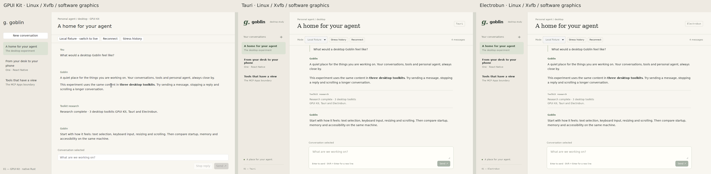

# Desktop toolkit MVP spike evidence

Run date: 2026-10-14. Worktree: `spike/desktop-toolkit-matrix`. This is local fixture evidence only; it does not establish Goblin dev, production, authenticated, macOS, Metal, VoiceOver, signing, notarization, or installer acceptance.

## What was built

| Shell      | Toolkit                         | Client surface                                                                   | Result             |
| ---------- | ------------------------------- | -------------------------------------------------------------------------------- | ------------------ |
| GPUI       | GPUI Kit 0.7.3                  | Rust retained native UI, `TextViewState` Markdown, virtualized `MessageScroller` | Linux smoke passed |
| Tauri      | Tauri 2.12.3                    | Shared retained DOM UI in the system WebView                                     | Linux smoke passed |
| Electrobun | Electrobun 2.0.2 / Hutch 0.27.1 | Shared retained DOM UI in a sandboxed system WebView, Bun main process           | Linux smoke passed |

All three use the same deterministic fixture and the same loopback companion. The companion binds to `127.0.0.1`, requires a random bearer capability and exact shell header, keeps each shell's state separate, and defaults to fixture mode. Live mode is explicit and reuses the mobile owner transport and Pi projection; no live sign-in or model call was made during this run.

## Checks

- `bun run check`: **PASS** — TypeScript typecheck; 6 service tests, 0 failures, 32 assertions; Vite build (10.79 kB JS, 5.60 kB CSS); browser acceptance **12 passed, 0 skipped**.
- `bun run electrobun:typecheck`: **PASS**.
- `bun run electrobun:build`: **PASS** — Electrobun dev bundle generated under `electrobun/build/dev-linux-x64/`.
- Disposable Linux image native build: **PASS** — `goblin-gpui-spike` and `goblin-tauri-spike` compiled offline.
- `cargo test --offline -p goblin-gpui-spike`: **PASS** — 1 headless GPUI interaction test; retained input and incremental Markdown state stayed intact.
- `scripts/linux-smoke.sh gpui`: **PASS** — launch, capture, stream, OS keyboard send, stress history, conversation switch.
- `scripts/linux-smoke.sh tauri`: **PASS** — same six cases.
- `scripts/linux-smoke.sh electrobun`: **PASS** — same six cases.

The native smoke runs used Xvfb, software graphics, and an isolated disposable dependency image on Linux. Their receipts are in ignored `artifacts/*-native-receipt.json`; screenshots cover initial, streamed, input, history, and switched-conversation states for each shell.

Native testing found a WebKitGTK fetch-stream delay at the last chunk of a burst: the final Stop state waited for the next write. The companion now sends a separate SSE comment 50 ms after a burst, keeping the final state prompt without polling or persistent high-frequency heartbeats. The final native tests include Enter-to-send immediately after stopping the previous reply.

The repository-wide `heavy bun run check` reached its existing formatting gate and stopped on `spikes/mobile/evidence/native-toolkit-research-2026-10-14.md`. Desktop-scoped formatting, lint, TypeScript, Rust formatting, and the checks above pass; this mobile evidence formatting issue is outside this spike's owned files.

## Comparison

GPUI is the best native-first candidate. It gives Goblin a Rust/GPU surface and a virtualized message list, but it requires a separate UI implementation and a native transport boundary. The MVP's GPUI composer is single-line and its native Markdown surface is not an MCP Apps host.

Tauri is the lowest-risk path for preserving Goblin's existing web UI and browser-oriented MCP Apps work. It inherits the system WebView and keeps the frontend in TypeScript, while the Rust host owns the window and loopback boundary.

Electrobun fits the existing Bun/TypeScript toolchain and also preserves the web UI. Its development bundle and Linux smoke pass, but the local WebView/GTK path needs native Mac review before choosing it for production. The GPU/native surface option was not used here.

No performance winner is established: startup, CPU, memory footprint and frame timing were not measured. The development artifacts use different bundling and optimization settings. The included sampler is for subsequent app-plus-companion RSS observations, with its limitations documented in the README.

## Mac follow-up

On the MacBook, run the companion locally and open each client with `bun run launch ...` or all three with `bun run compare`. Compare cold and warm startup, idle/stress-history memory with the included sampler, scroll/input latency, text selection, IME composition, clipboard, sleep/resume, native window controls, VoiceOver, and WebView MCP App behavior. Use Instruments for Metal/frame timing and Activity Monitor for the full app plus companion process tree. Production would also need a supervised sidecar or host-owned transport, OS keychain storage for live sessions, and signed/notarized packaging.
